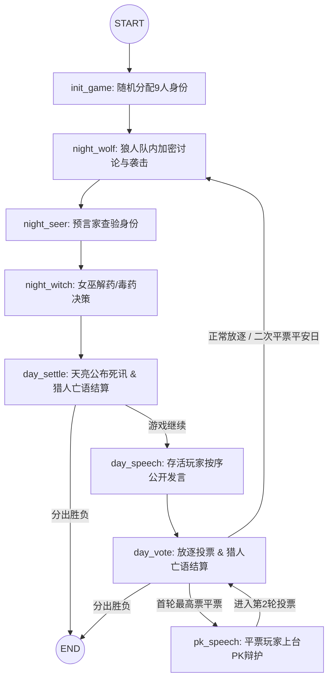

# 🐺 WolfGame — 基于 LangGraph 的狼人杀多智能体博弈系统

**WolfGame** 是一个基于 **LangGraph** 状态机与大语言模型（LLM）构建的 **9 人局狼人杀（3 狼、3 民、预言家、女巫、猎人）** 多智能体（Multi-Agent）自动博弈与观战平台。

系统通过“上帝状态机 + 角色视野隔离器 + 双层结构化决策（内心戏 Thought & 公开言行 Speech）”还原了标准的不完全信息博弈，并提供 **Streamlit 实时圆桌观战界面** 与 **Markdown/JSON 战报自动复盘系统**。

---

## ✨ 核心特性

* **🎭 严格的视野隔离（不完全信息博弈）**：虽然全局 `GameState` 维护上帝视角数据，但每次调用智能体前均经过 `get_player_context` 过滤，确保村民无法窥探狼刀、好人无法越权共享预言家查验记录。
* **🧠 表里不一的双层推理（CoT 驱动）**：利用 Pydantic 结构化输出，强制 AI 先生成私密的 `thought`（真实身份盘算、悍跳/倒钩/藏身份策略），再输出公开的 `speech` 或 `target_id`，有效杜绝大模型“说漏嘴自曝狼人”的问题。
* **🐺 狼人夜晚加密协商机制**：存活的多名狼人在夜晚开启队内加密频道，按顺位提议袭击目标并商讨次日白天的悍跳与冲票战术（支持多数票决与尾狼拍板），且加密记录跨天保留。
* **⚖️ 完整的标准 9 人局规则引擎**：
* **屠边规则**：狼人全灭则好人胜；神职全灭或平民全灭则狼人胜。
* **神职技能闭环**：支持预言家夜间验人、女巫解药/毒药双药管理、猎人夜间倒牌（非毒死）及白天放逐开枪带人。
* **平票 PK 环路**：首轮放逐投票出现最高票平票时，自动触发平票玩家专属 PK 辩护发言与二次投票；二次平票则自动判定为“平安日”。


* **🖥️ 双模式运行 & 自动战报复盘**：支持 CLI 终端运行与 Streamlit Web 实时观战台（可自由开关“上帝视角”查看底牌与内心戏），对局结束后在 `logs/` 目录自动导出完整的 `.json` 状态数据与 `.md` 复盘战报。

---

## 📂 项目目录结构

```text
WolfGame/
├── logs/                        # 📂 自动生成的对局日志与复盘战报[cite: 1]
│   ├── game_YYYYMMDD_HHMMSS.json    # 对局完整状态快照 (JSON)[cite: 1]
│   └── report_YYYYMMDD_HHMMSS.md    # 上帝视角全流程复盘战报 (Markdown)[cite: 1]
├── src/                         # 📦 核心源码目录[cite: 1]
│   ├── agents/[cite: 1]
│   │   └── player_agent.py      # 智能体封装：LLM 结构化调用、重试机制与角色 Prompt[cite: 1]
│   ├── config/[cite: 1]
│   │   ├── llm.py               # 大模型客户端初始化配置[cite: 1]
│   │   └── role.py              # 角色枚举与中文名称映射[cite: 1]
│   ├── graph/[cite: 1]
│   │   ├── builder.py           # LangGraph 状态图组装与编译[cite: 1]
│   │   ├── nodes.py             # 核心业务节点（狼人/预言家/女巫/结算/发言/投票/PK）[cite: 1]
│   │   └── routers.py           # 条件边路由函数（胜负判定跳转、平票 PK 分支跳转）[cite: 1]
│   ├── models/[cite: 1]
│   │   ├── player.py            # 玩家基础属性数据结构[cite: 1]
│   │   ├── schemas.py           # Pydantic 结构化输出 Schema (Target/Speech/Witch/Wolf)[cite: 1]
│   │   └── state.py             # LangGraph 全局状态 GameState 定义[cite: 1]
│   ├── recorder/[cite: 1]
│   │   └── logger.py            # 战报记录器：导出 JSON 明细与渲染 Markdown 复盘报告[cite: 1]
│   └── rules/[cite: 1]
│       └── win_conditions.py    # 规则引擎：屠边胜负判定、视野过滤器、目标合法性兜底校验[cite: 1]
├── .env                         # 🔑 环境变量配置文件 (API Key / Base URL / Model)[cite: 1]
├── app_ui.py                    # 🖥️ Streamlit 可视化实时圆桌观战前端[cite: 1]
└── main.py                      # 🚀 命令行 (CLI) 模式启动入口[cite: 1]

```

---

## 🔄 LangGraph 状态机拓扑流转



---

## 🛠️ 快速开始

### 1. 环境准备

建议使用 Python 3.10+ 虚拟环境（如 Conda）：

```bash
conda create -n agent python=3.11
conda activate agent
pip install langgraph langchain-openai langchain-core pydantic python-dotenv streamlit json-repair

```

### 2. 配置环境变量 (`.env`)

在项目根目录下配置 `.env` 文件（支持 OpenAI、DeepSeek、Qwen 等所有兼容 OpenAI 格式的接口）：

```env
OPENAI_API_KEY="sk-xxxxxxxxxxxxxxxxxxxxxxxxxxxxxxxx"
OPENAI_BASE_URL="https://api.deepseek.com"
LLM_MODEL="deepseek-chat"

```

### 3. 启动方式

#### 方式一：启动 Streamlit 可视化观战台（推荐）

```bash
streamlit run app_ui.py

```

* 在左侧控制台可随时切换 **“👁️ 开启上帝视角”**（实时查看各玩家底牌、狼人夜聊、神职用药及每句发言背后的 AI 内心算计）。
* 支持调节节点播放间隔，对局结束后自动在 `logs/` 下生成复盘报告。

#### 方式二：启动命令行 (CLI) 终端模式

```bash
python main.py

```

* 在控制台实时打印昼夜交替、AI 内心戏与投票过程，并在终局后自动输出 Markdown 复盘战报路径。

---

## 📊 复盘战报预览 (`logs/report_*.md`)

每局游戏结束后，`src/recorder/logger.py` 会将 `event_logs` 渲染为结构化的 Markdown 战报，包含：

1. **对局概览与全员底牌终局表**
2. **夜晚狼人加密战术讨论记录与神职暗箱操作**
3. **白天全员公开发言 vs 真实内心戏对照**
4. **每日放逐投票去向与平票 PK 明细**